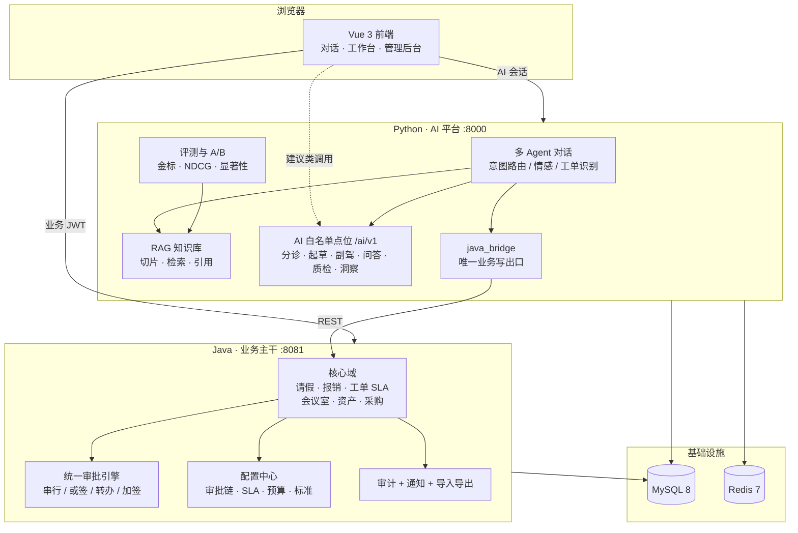
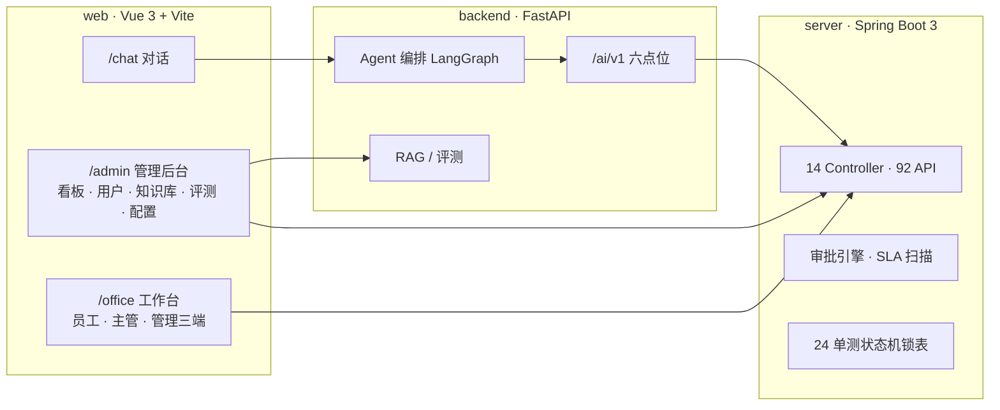

# 知流 · Zhiliu

**企业智能服务台**（产品名：知流） —— 传统业务主干（Java）+ 对话式 AI（Python）+ 统一前端（Vue 3）。

面向中大型组织的请假 / 报销 / 工单 / 会议室 / 资产 / 采购全流程，叠加多 Agent 客服、RAG 知识问答与可插拔 AI 白名单点位。业务状态机与审批链可配置，AI 挂掉后业务仍可纯表单运转。

---

## 系统架构



**设计原则**

| 原则 | 说明 |
|---|---|
| 业务单源 | 单据、审批、审计只落 Java；Python 不写业务台账 |
| AI 白名单 | 模型只产出建议字段与草稿，不直接改终态 |
| 可降级 | 关闭 AI 开关 → 分诊/起草回退规则或人工，业务表单不受影响 |
| 配置驱动 | 审批链、SLA、报销标准入库，新单生效、旧单锁提交快照 |

---

## 模块地图



| 目录 | 技术 | 职责 |
|---|---|---|
| `zhiliu/web` | Vue 3 · Vite · Tailwind | 三端工作台、管理后台、对话 |
| `zhiliu/backend` | FastAPI · LangGraph · RAG | 对话 Agent、知识库、AI 点位、评测 |
| `zhiliu/server` | Spring Boot 3 · MyBatis-Plus | 业务主干、审批、配置、审计 |
| `zhiliu/server/sql` | MySQL | `init.sql` 一键建库（32 表 + 种子） |
| `zhiliu/docs` | — | 业务设计与验收标准 |
| `zhiliu/deploy` | Docker Compose | Python 栈容器编排 |

---

## 快速开始

```bash
# 1. 建库（含演示数据）
mysql -uroot -p mianshi < zhiliu/server/sql/init.sql

# 2. 一键起服务（Redis → Java → Python → Vite）
powershell -ExecutionPolicy Bypass -File zhiliu/server/start-all.ps1
# 或分别启动：
#   Java:  cd zhiliu/server && mvn -pl smartflow-server -am spring-boot:run   # :8081
#   Python: cd zhiliu/backend && uvicorn app.main:app --port 8000
#   前端:  cd zhiliu/web && npm i && npm run dev                             # :5173

# 3. 打开 http://127.0.0.1:5173
```

**演示账号**（密码均为 `123456`，仅限本地开发）：

| 用户 | 角色 |
|---|---|
| `zhangsan` | 普通员工 |
| `liming` | 部门主管 |
| `wangwu` / `zhaoliu` | 人事 / 财务 |
| `admin` | 管理员 |

健康检查：`http://127.0.0.1:8081/actuator/health` · `http://127.0.0.1:8000/health`

---

## 核心能力

### 业务主干（Java）

- **请假 / 报销**：规则校验、预算 hold、发票与限额打标、幂等提交、配置化审批链与链快照
- **工单**：状态机（单测锁迁移）、SLA 四级 + 分钟级扫描 + 破线升级
- **会议室**：时段防超卖、签到 / 取消 / 爽约释放
- **资产**：领用 → 维修 → 丢失 → 赔偿 → 报废；离职五门槛 checklist
- **采购**：需求 → ≥2 家比价 → 审批 → 下单 → 验收
- **配置中心**：假种 / SLA / 审批模板 / 部门 / 报销标准 / 预算 / 角色 / 会议室 / 资产分类
- **列表五件套**：分页搜索 + Excel 导入导出

### AI 能力（Python）

| 能力 | 说明 |
|---|---|
| 多 Agent 对话 | 情感 → 知识库门控 → 意图路由 → 部门/FAQ/工单 Agent |
| RAG | 文档切片、混合检索、带引用回答 |
| **六点位白名单** | 分诊 / 起草 / 副驾 / 问答 / 质检 / 运营洞察，LLM 优先、规则回退 |
| 全局降级 | `/ai/v1/switch` 一键关闭 AI，业务纯表单可用 |
| 评测 | 金标用例、检索与生成双层指标、A/B 配对显著性 |

### 质量门禁

| 门禁 | 规模 |
|---|---|
| Java 单测 | 24（状态机 / 边界规则 / 审批链形状） |
| 前端单测 | 15（路由收口、会话、工作台与配置不变量） |
| 健康检查 | Spring Actuator + FastAPI `/health` |

```bash
# Java
cd zhiliu/server && mvn test
# 前端
cd zhiliu/web && npm test
```

---

## RAG 评测与显著性

金标 **123** 条（可答 108 + 负例拒答 15），覆盖 8 类业务域；检索 / 生成双层指标，
配对 **McNemar**（Hit@1）+ **bootstrap 1000 次**（分数指标），95% CI、p&lt;0.05 判显著。

| 实验 | 指标 | before → after | 显著性 |
|---|---|---|---|
| 关闭 cross-encoder 精排 → 开启 | Hit@1 | **59.3% → 72.2%**（+11.4pp） | p=0.007 |
| | MRR | **73.2% → 82.1%**（+8.9pp） | p=0.002 |
| | NDCG@5 | **77.5% → 83.5%**（+6.0pp） | p=0.006 |
| 扩大候选 top_k+2（生成层） | 忠实性 | **97.2% → 99.4%**（+2.2pp） | p=0.026 |
| | 负例拒答率 | **93.3% → 100%** | — |
| 查询重写开关 | Recall@5 | 93.1% → 94.4% | 不显著（CI 含 0，默认不启用） |

**口径说明：** 检索返回 top5 进入生成上下文，主指标为 **Recall@5（约 93%）**；
Hit@1 衡量「第一名即正确」，精排显著提升。管理后台「RAG 评测」可复跑 A/B 并查看 Δ±CI。

**复跑：** 管理端 → RAG 评测 → 跑检索/生成；或 `POST /eval/run?variant=A&rerank=false` 做消融。

## 数据与安全（开发环境）

- MySQL 表前缀 `sf_`；演示种子见 `zhiliu/server/sql/seed_demo_data.sql`
- `.env` / 密钥 / 截图 / `target/` / `node_modules` **不入库**（见根目录 `.gitignore`）
- 生产部署前务必更换：数据库口令、JWT Secret、业务账号默认密码

---

## 技术栈

| 层 | 选型 |
|---|---|
| 前端 | Vue 3 · Vite · Vue Router · Pinia 风格组合式 · Tailwind · ECharts |
| AI | FastAPI · LangGraph · LangChain · OpenAI 兼容网关 · Redis 限流 |
| 业务 | Java 21 · Spring Boot 3 · MyBatis-Plus · JWT · POI |
| 数据 | MySQL 8 · Redis 7 |

---

## 文档

- 业务设计与验收：`zhiliu/docs/BUSINESS_DESIGN_v2.md`
- Java 侧接口与里程碑：`zhiliu/server/README.md`

---

## License

知流（Zhiliu）仅供学习与作品集展示；演示数据与默认口令不得用于生产。
