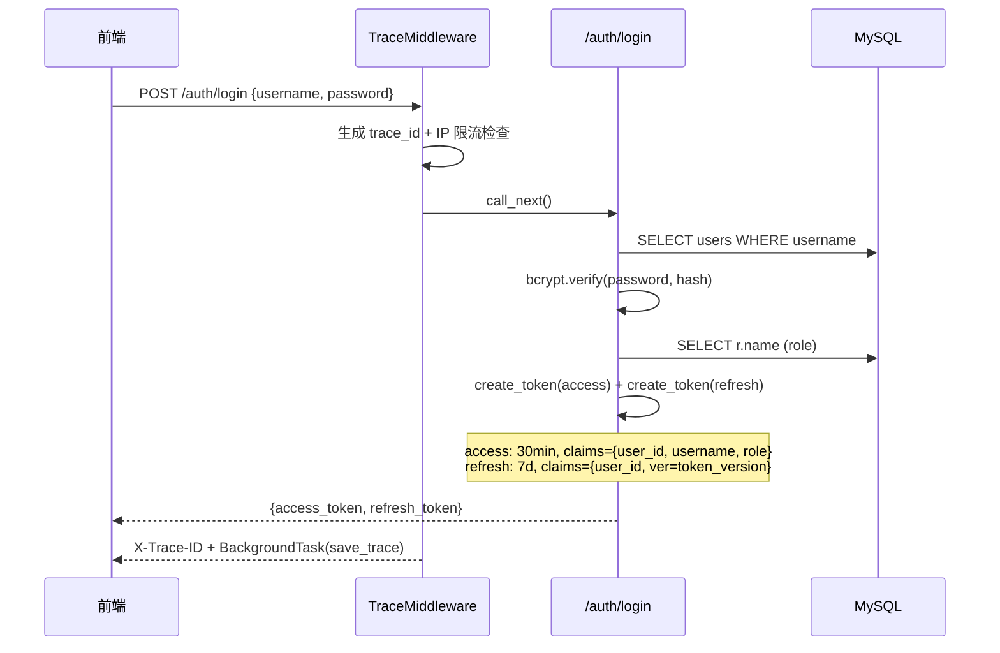
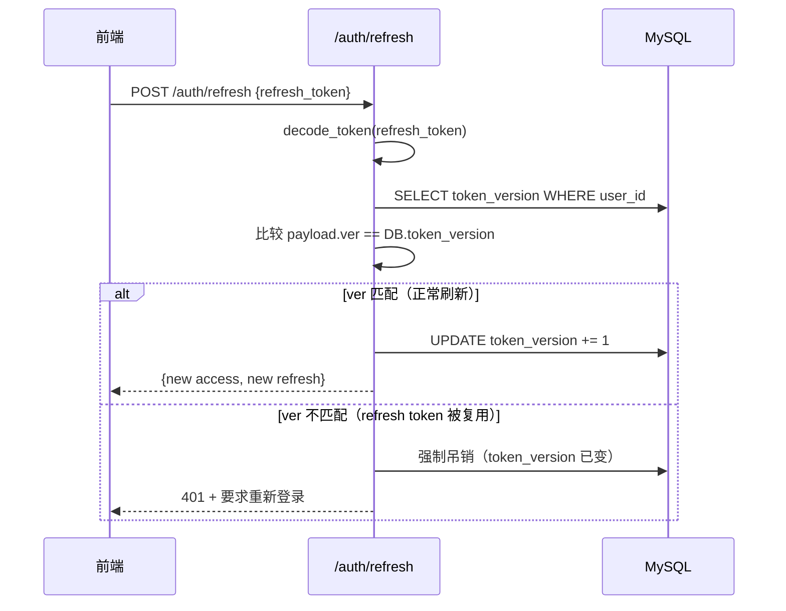
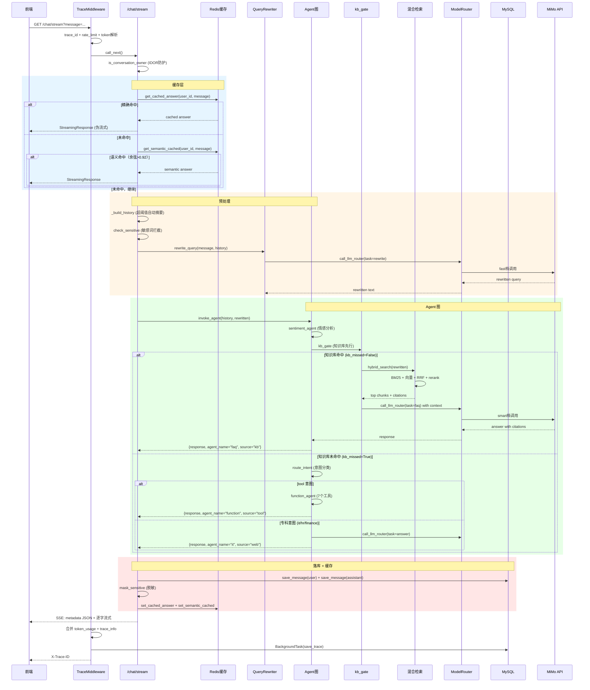
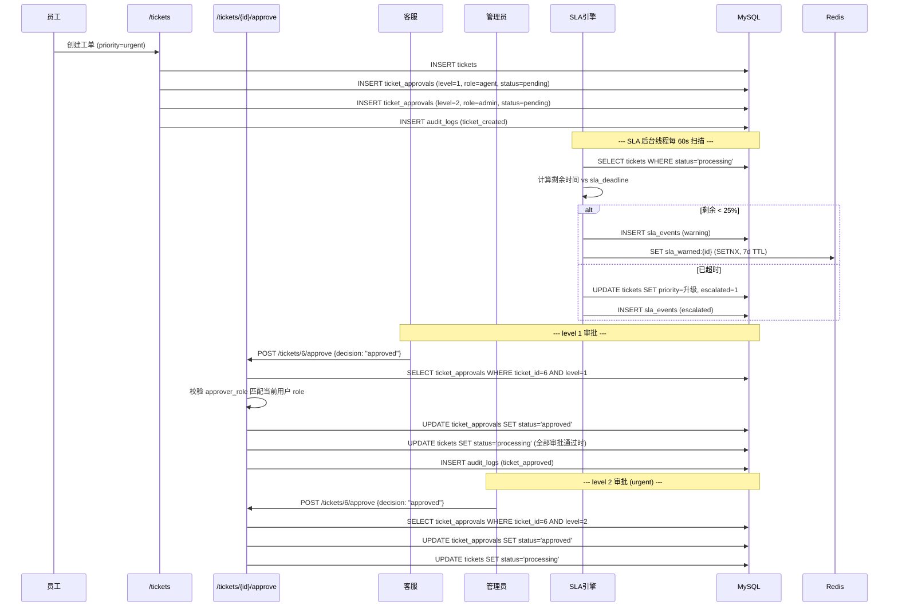
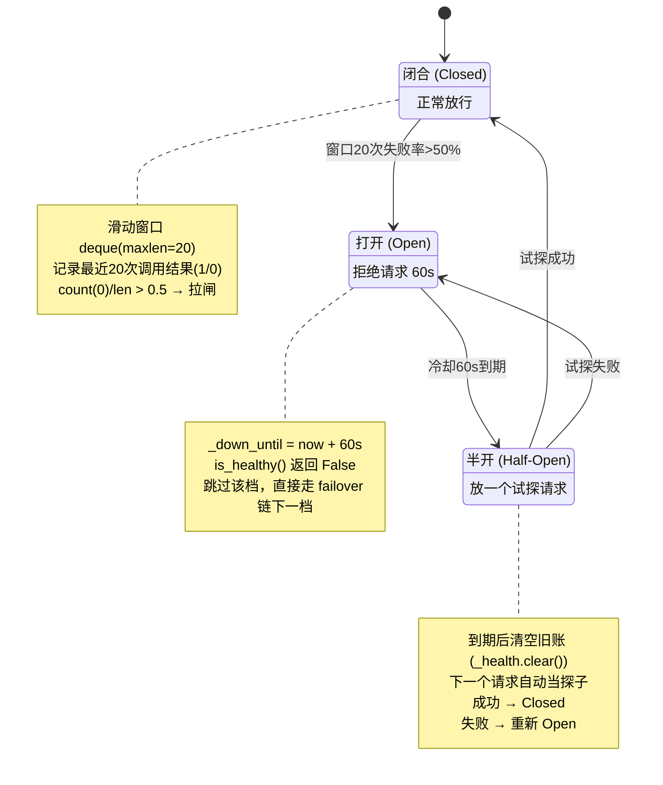

# SmartFlow 架构文档

> 时序图 + 状态机 + 关键设计决策。

---

## 1. 认证与 Token 管理

### 1.1 登录时序



### 1.2 Refresh Token 轮换



**设计要点**：
- access token 短期（30min）不查 DB，role 从 claims 读
- refresh token 轮换：每次刷新 `token_version += 1`，旧 refresh 立即失效
- 复用检测：被盗的 refresh token 再次使用时，ver 不匹配 → 强制所有会话重新登录

---

## 2. 聊天全链路

### 2.1 主时序



### 2.2 关键设计决策

| 决策 | 说明 |
|------|------|
| 缓存 user_id 隔离 | key 格式 `chat:{user_id}:{question}`，防止跨用户缓存泄漏 |
| kb_gate 先行 | 知识库能接住就不走 LLM 路由，节省成本 |
| 混合检索四层漏斗 | BM25 关键词 → 向量语义 → RRF 名次融合 → cross-encoder 精排 |
| 伪流式 | 全量生成后逐字吐，首 token 延迟 = 全量生成时间（真流式需 async 全链路改造） |
| token 回填 | 每次 LLM 调用后 `add_token_usage()` 累加到 ContextVar，middleware 合并后写 DB |

---

## 3. 工单审批流

### 3.1 状态机

```mermaid
stateDiagram-v2
    [*] --> pending: 创建工单

    state "低优先级 (low/normal)" as low {
        pending --> processing: 自动通过
    }

    state "高优先级 (high)" as high {
        pending --> pending_L1: 创建审批链
        pending_L1 --> processing: agent 审批通过
        pending_L1 --> rejected: agent 驳回
    }

    state "紧急 (urgent)" as urgent {
        pending --> pending_L1: 创建审批链
        pending_L1 --> pending_L2: agent 通过
        pending_L1 --> rejected: agent 驳回
        pending_L2 --> processing: admin 通过
        pending_L2 --> rejected: admin 驳回
    }

    processing --> resolved: 客服标记解决
    resolved --> [*]
    rejected --> [*]
```

### 3.2 审批 + SLA 时序



**设计要点**：
- 审批链按 priority 预生成：high=1级，urgent=2级
- 每级审批校验 `approver_role` 匹配当前用户 role
- SLA 引擎：后台线程 60s 扫描，Redis SETNX 防重复预警
- 超时自动升优先级：low→normal→high→urgent

---

## 4. 模型熔断器

### 4.1 状态机



### 4.2 三档模型 failover 链

| 档位 | 任务类型 | 模型 | timeout | cost_weight | failover 链 |
|------|---------|------|---------|-------------|------------|
| fast | rewrite/intent/sentiment/title/summarize | v2.6-flash | 10s | 1 | fast→smart→backup |
| smart | answer/faq/agent/function_calling | v2.6-pro | 15s | 3 | smart→backup |
| backup | 兜底 | v2.5-flash | 20s | 2 | backup→smart |

**故障案例**：mimo-v2.5 下架期间，fast 档连续失败 → 滑动窗口失败率超 50% → 熔断器拉闸 60s → failover 链自动切到 smart 档（成本 1:3，可用性优先）→ 60s 后半开试探 → v2.5 恢复后自动回切。

---

## 5. 可观测性

### 5.1 请求链路追踪

```
请求进入
  │
  ├─ TraceMiddleware
  │    ├─ 生成 trace_id (uuid 前12位)
  │    ├─ 双写: request.state + ContextVar
  │    ├─ 限流检查 (Redis)
  │    ├─ call_next()
  │    ├─ 合并 token_usage (ContextVar)
  │    ├─ 合并 trace_info (request.state)
  │    ├─ 后台写 request_traces 表
  │    ├─ 控制台 JSON 日志 (logger.py)
  │    └─ Prometheus 指标 (/metrics)
  │
  └─ 任意深度业务代码
       ├─ get_logger(__name__).info(...)  ← 自动带 trace_id
       ├─ get_trace_id()                  ← 显式获取
       └─ add_token_usage(in, out)        ← LLM 调用后累加
```

### 5.2 Prometheus 指标

| 指标 | 类型 | 标签 | 用途 |
|------|------|------|------|
| http_requests_total | Counter | method, path, status | QPS + 错误率 |
| http_request_duration_seconds | Histogram | method, path | P95 延迟 |
| llm_calls_total | Counter | tier, task_type, status | LLM 成功率 |
| llm_call_duration_seconds | Histogram | tier | LLM 延迟 |
| circuit_breaker_state | Gauge | tier | 熔断器状态 (0闭合/1打开) |
| cache_lookups_total | Counter | kind, result | 缓存命中率 |
| rate_limit_rejected_total | Counter | layer | 限流触发次数 |

**设计决策**：
- `/metrics` 不鉴权：Prometheus 内部 scrape 标准做法，K8s 里只走集群内 Service
- 指标基数控制：path 用原始路径不用路由模板，避免 `/chat/{id}` 基数爆炸
- token 回填链路：OpenAI `completion.usage` → ContextVar → middleware 合并 → DB

---

## 6. 文件上传流式落盘

```
旧版（内存问题）:
  UploadFile.read() → 300MB 全量读入内存 → 写临时文件 → 检查大小

新版（峰值内存 1MB）:
  while chunk = file.read(1MB):
    written += 1MB
    if written > MAX_UPLOAD_SIZE:  → 413 + 清理临时文件
    tmp.write(chunk)
```

`UploadFile` 底层是 SpooledTemporaryFile（超过阈值落盘），但 `.read()` 会把整个文件读进内存。改成 1MB 分块循环写，峰值内存从 300MB 降到 1MB。

---

## 7. 关键数据流汇总

| 场景 | 数据流 |
|------|--------|
| 登录 | HTTP body → bcrypt.verify → JWT(claims+role) → 前端存 localStorage |
| 聊天 | message → 缓存 → 历史 → 敏感词 → 改写 → Agent图 → 脱敏 → 落库 → 缓存 → SSE |
| RAG | query → BM25(MySQL) + 向量(ChromaDB) → RRF融合 → cross-encoder精排 → top chunks |
| 工单 | 创建 → 审批链 → 客服处理 → SLA扫描 → CSAT评分 |
| 熔断 | LLM调用 → mark_result → 滑动窗口 → 失败率>50% → 拉闸 → failover |
| Trace | 请求 → trace_id → ContextVar → 业务层 get_logger/token_usage → middleware合并 → MySQL |
