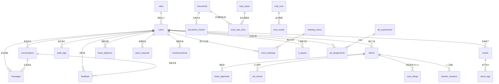

# SmartFlow 数据库设计

> 共 28 张活跃表，分 6 个域：核心业务 / 工单 SLA / 知识库 / 可观测 / 工具数据 / RAG 评测。

---

## 全景 ERD

---

## 1. 核心业务域

### users — 用户表

| 字段 | 类型 | 说明 |
|------|------|------|
| id | INT PK | 自增 |
| username | VARCHAR UNIQUE | 登录名 |
| password_hash | VARCHAR | bcrypt 哈希（不存明文） |
| role | VARCHAR | 冗余字段：`user`/`agent`/`admin`（快速查询用） |
| role_id | INT FK → roles.id | 规范化角色（改角色只需改 roles） |
| status | VARCHAR | `active`/`disabled` |
| token_version | INT | refresh token 轮换：递增后旧 refresh 全部失效 |
| created_at | DATETIME | 注册时间 |

**设计决策**：role 和 role_id 并存——role 是冗余字段避免每次 JOIN，role_id 保持规范化。登录时把 role 写进 JWT claims，后续请求免查 DB。

### roles — 角色表

| 字段 | 类型 | 说明 |
|------|------|------|
| id | INT PK | 1=admin 2=agent 3=user |
| name | VARCHAR | 角色名 |
| description | VARCHAR | 描述 |

**为什么单独建表**：支持角色扩展（未来加 `finance_approver` 等），同时 users.role_id 外键保证完整性。

### conversations — 对话会话

| 字段 | 类型 | 说明 |
|------|------|------|
| id | INT PK | |
| user_id | INT FK → users.id | 会话所有者（IDOR 防护依据） |
| title | VARCHAR(200) | 自动生成（首条消息后 LLM 生成） |
| tags | VARCHAR(100) | 逗号分隔标签 |
| conversation_summary | TEXT | 长对话自动摘要（超过阈值压缩历史） |
| summary_msg_count | INT | 已摘要的消息数 |
| created_at / updated_at | DATETIME | |

**安全设计**：`user_id` 是 IDOR 防护的依据。`save_message` 前先查 `WHERE id=%s AND user_id=%s`，不匹配返回 404（不用 403 防枚举）。

### messages — 消息表

| 字段 | 类型 | 说明 |
|------|------|------|
| id | INT PK | |
| conversation_id | INT FK → conversations.id | |
| role | VARCHAR | `user`/`assistant` |
| agent_name | VARCHAR | 处理该消息的 Agent（faq/it/hr/finance/function/chat） |
| source | VARCHAR | 回答来源：`kb`/`web`/`tool`/`none` |
| content | TEXT | 消息内容 |
| citations | JSON | RAG 引用来源 `[{index, document_name}]` |
| created_at | DATETIME | |

### feedback — 消息反馈

| 字段 | 类型 | 说明 |
|------|------|------|
| id | INT PK | |
| conversation_id | INT FK | |
| message_id | INT FK → messages.id | 被评价的消息 |
| user_id | INT FK → users.id | 评价人 |
| rating | TINYINT | 1=赞 0=踩 |
| agent_name | VARCHAR | 冗余，方便按 Agent 统计好评率 |
| created_at | DATETIME | |

**设计决策**：feedback 表驱动「反馈闭环」——踩的样本自动进入 RAG 评测的 hard case 池。

---

## 2. 工单 SLA 域

### tickets — 工单

| 字段 | 类型 | 说明 |
|------|------|------|
| id | INT PK | |
| user_id | INT FK → users.id | 提交人 |
| title | VARCHAR(200) | |
| content | TEXT | 问题描述 |
| category | VARCHAR | `it`/`hr`/`finance`/`admin` |
| status | VARCHAR | `pending`/`processing`/`resolved`/`rejected` |
| department | VARCHAR | 负责部门 |
| priority | VARCHAR | `low`/`normal`/`high`/`urgent` |
| sla_deadline | DATETIME | SLA 截止时间（由 priority 计算） |
| escalated | TINYINT | 是否已被 SLA 升级 |
| created_at / updated_at | DATETIME | |

**SLA 计算规则**：
- low → 48h, normal → 24h, high → 8h, urgent → 4h
- `sla_engine` 后台线程每 60s 扫描，剩余 <25% 发预警，超时自动升 priority

### ticket_approvals — 审批链

| 字段 | 类型 | 说明 |
|------|------|------|
| id | INT PK | |
| ticket_id | INT FK → tickets.id | |
| level | TINYINT | 审批层级（1=客服 2=管理员） |
| approver_role | VARCHAR | 需要的角色：`agent`/`admin` |
| status | VARCHAR | `pending`/`approved`/`rejected` |
| comment | VARCHAR(500) | 审批意见 |
| decided_by | INT FK → users.id | 决策人 |
| decided_at | DATETIME | 决策时间 |
| created_at | DATETIME | |

**审批链规则**：
- `normal`/`low` → 无需审批，直接 `processing`
- `high` → level 1 (agent) 审批
- `urgent` → level 1 (agent) → level 2 (admin) 两级审批

### sla_events — SLA 事件

| 字段 | 类型 | 说明 |
|------|------|------|
| id | INT PK | |
| ticket_id | INT FK → tickets.id | |
| event_type | VARCHAR | `warning`/`escalated` |
| from_priority | VARCHAR | 升级前优先级（escalated 时有值） |
| to_priority | VARCHAR | 升级后优先级 |
| note | VARCHAR | 事件说明 |
| created_at | DATETIME | |

### csat_ratings — 满意度评分

| 字段 | 类型 | 说明 |
|------|------|------|
| id | INT PK | |
| ticket_id | INT UNIQUE FK → tickets.id | **一单一评**（唯一键兜底） |
| user_id | INT FK → users.id | 评分人 = 工单提交人 |
| score | TINYINT | 1-5 星 |
| comment | VARCHAR(500) | |
| created_at | DATETIME | |

**设计决策**：`ticket_id UNIQUE` 保证一单一评，即使前端重复提交也不会产生重复评分。

### transfer_sessions — 人工转接

| 字段 | 类型 | 说明 |
|------|------|------|
| id | INT PK | |
| ticket_id | INT FK → tickets.id | |
| user_id | INT FK → users.id | 发起人 |
| agent_id | INT FK → users.id | 目标客服 |
| reason | VARCHAR | 转接原因 |
| status | VARCHAR | `waiting`/`connected`/`declined` |
| created_at | DATETIME | |

---

## 3. 知识库域

### documents — 文档元数据

| 字段 | 类型 | 说明 |
|------|------|------|
| id | INT PK | |
| filename | VARCHAR(200) | 文件名（评测期望文档的匹配依据） |
| category | VARCHAR | 分类 |
| file_path | VARCHAR | 存储路径 |
| chunk_count | INT | 分块数 |
| is_latest | TINYINT | 版本控制：1=最新版 |
| version | INT | 版本号 |
| uploaded_by | INT FK → users.id | |
| created_at | DATETIME | |

### document_chunks — 文档分块

| 字段 | 类型 | 说明 |
|------|------|------|
| id | INT PK | |
| document_id | INT FK → documents.id | |
| chunk_index | INT | 分块序号 |
| content | TEXT | 分块文本 |
| embedding_id | VARCHAR | ChromaDB 中的向量 ID |

**混合检索数据流**：BM25 查 MySQL `document_chunks.content`（ngram 全文索引），向量查 ChromaDB，RRF 融合。

---

## 4. 可观测域

### request_traces — 请求链路

| 字段 | 类型 | 说明 |
|------|------|------|
| id | INT PK | |
| trace_id | VARCHAR(12) | 全链路追踪 ID（uuid 前 12 位） |
| user_id | INT FK → users.id | |
| method | VARCHAR | HTTP 方法 |
| path | VARCHAR | 请求路径 |
| status_code | INT | HTTP 状态码 |
| total_time | DECIMAL | 总耗时（秒） |
| input_tokens | INT | LLM 输入 token |
| output_tokens | INT | LLM 输出 token |
| agent_name | VARCHAR | 处理 Agent |
| sentiment | VARCHAR | 情感分析结果 |
| intent | VARCHAR | 意图分类结果 |
| error_msg | VARCHAR(200) | 错误信息（异常时） |
| created_at | DATETIME | |

**数据流**：token 用量回填——OpenAI `completion.usage` → ContextVar 累加 → middleware 合并 → save_trace 写入。

### audit_logs — 审计日志

| 字段 | 类型 | 说明 |
|------|------|------|
| id | INT PK | |
| user_id | INT FK → users.id | |
| action | VARCHAR | `login_success`/`sensitive_blocked`/`ticket_approved`/`asset_scrap`/`kb_upload`/`role_update` |
| detail | VARCHAR(500) | 详细信息 |
| ip | VARCHAR | 客户端 IP |
| created_at | DATETIME | |

---

## 5. 工具数据域（Function Calling 数据源）

这些表是 Function Agent 7 个工具的数据后端，Agent 通过 tool_registry 查/写这些表。

### leave_balances — 假期余额

| 字段 | 类型 | 说明 |
|------|------|------|
| user_id | INT PK FK → users.id | 一人一行 |
| annual_leave | DECIMAL | 年假余额（天） |
| sick_leave | DECIMAL | 病假余额 |
| comp_leave | DECIMAL | 调休余额 |
| updated_at | DATETIME | |

### leave_requests — 请假申请

| 字段 | 类型 | 说明 |
|------|------|------|
| id | INT PK | |
| user_id | INT FK | |
| leave_type | VARCHAR | `annual`/`sick`/`comp` |
| start_date / end_date | DATE | 请假区间 |
| days | DECIMAL | 天数 |
| reason | VARCHAR(200) | |
| approver_id | INT FK | 审批人 |
| status | VARCHAR | `pending`/`approved`/`rejected` |

### reimbursements — 报销

| 字段 | 类型 | 说明 |
|------|------|------|
| id | INT PK | |
| user_id | INT FK | |
| amount | DECIMAL(10,2) | 金额 |
| category | VARCHAR | `meal`/`travel`/`equipment`/`taxi` |
| description | VARCHAR(200) | |
| status | VARCHAR | `pending`/`approved`/`paid`/`rejected` |

### meeting_rooms + room_bookings — 会议室

| 字段 | 类型 | 说明 |
|------|------|------|
| meeting_rooms.id | INT PK | |
| name / capacity / location / equipment | | 会议室属性 |
| room_bookings.room_id | INT FK | 预订的会议室 |
| book_date / start_time / end_time | | 预订时间 |
| purpose | VARCHAR | 用途 |
| status | VARCHAR | `confirmed`/`pending`/`cancelled` |

### it_assets — IT 设备

| 字段 | 类型 | 说明 |
|------|------|------|
| user_id | INT FK | 使用人 |
| asset_type | VARCHAR | `laptop`/`monitor`/`phone` |
| asset_name / asset_tag | VARCHAR | 设备名/标签 |
| status | VARCHAR | `normal`/`repairing` |

---

## 6. RAG 评测域

### eval_cases — 评测用例

| 字段 | 类型 | 说明 |
|------|------|------|
| id | INT PK | |
| question | VARCHAR(200) | 测试问题 |
| expect_doc | VARCHAR(200) | 主期望文档（负例为 NULL） |
| category | VARCHAR | `hr`/`it`/`finance`/`admin`/`compliance`/`unanswerable` |
| is_answerable | TINYINT | 0=负例（知识库无答案，只评拒答率） |
| is_active | TINYINT | 是否启用 |

### eval_case_docs — 多标签期望文档

| 字段 | 类型 | 说明 |
|------|------|------|
| id | INT PK | |
| case_id | INT FK → eval_cases.id | |
| doc_filename | VARCHAR(200) | 期望文档文件名 |
| grade | TINYINT | 2=主期望 1=可接受（NDCG 区分主次） |

**设计决策**：单标签会误判（如「培训预算」在两个文档都出现），多标签 + NDCG grade 区分解决这个问题。

### eval_runs — 评测运行

| 字段 | 类型 | 说明 |
|------|------|------|
| id | INT PK | |
| variant | CHAR(1) | 实验组 A/B |
| case_count / top_k | INT | |
| rewrite | TINYINT | 是否开启查询重写 |
| mode | VARCHAR | `retrieval`/`generation` |
| hit1 / recall5 / mrr / ndcg5 | DECIMAL | 检索层指标 |
| faithfulness / relevance | DECIMAL | 生成层 LLM 评审 |
| lat_p50_ms / lat_p95_ms | INT | 耗时分位 |
| refusal_rate | DECIMAL | 负例拒答率 |
| kb_snapshot | JSON | 知识库快照（版本追溯） |

### eval_results — 评测明细

| 字段 | 类型 | 说明 |
|------|------|------|
| run_id | INT FK → eval_runs.id | |
| case_id | INT | |
| hit | TINYINT | 是否命中（负例存 0） |
| first_rank | INT | 最好名次 |
| retrieved | JSON | 检索到的文档列表 |
| answer | MEDIUMTEXT | 生成答案（generation 模式） |
| judge | JSON | LLM 评审结果 |

---

## 7. 其他

### assets + asset_logs — 资产台账

assets 记录固定资产（笔记本/显示器/手机/工牌），asset_logs 记录每次操作流水（入库/领用/归还/报废）。

### ab_experiments + ab_assignments — A/B 实验

ab_experiments 定义实验（如「检索广度对比」），ab_assignments 记录用户分组。B 组检索 top_k+2。

### chat_history — 遗留表

早期版本的对话历史，已被 conversations + messages 取代。WIPE 列表中保留是为了清理旧数据。

---

## 表数量统计

| 域 | 表数 | 表名 |
|----|------|------|
| 核心业务 | 5 | users, roles, conversations, messages, feedback |
| 工单 SLA | 5 | tickets, ticket_approvals, sla_events, csat_ratings, transfer_sessions |
| 知识库 | 2 | documents, document_chunks |
| 可观测 | 2 | request_traces, audit_logs |
| 资产 | 2 | assets, asset_logs |
| AB 实验 | 2 | ab_experiments, ab_assignments |
| 工具数据 | 6 | leave_balances, leave_requests, reimbursements, meeting_rooms, room_bookings, it_assets |
| RAG 评测 | 4 | eval_cases, eval_case_docs, eval_runs, eval_results |
| 遗留 | 1 | chat_history |
| **合计** | **29** | 核心活跃表 28 张（chat_history 为遗留） |
